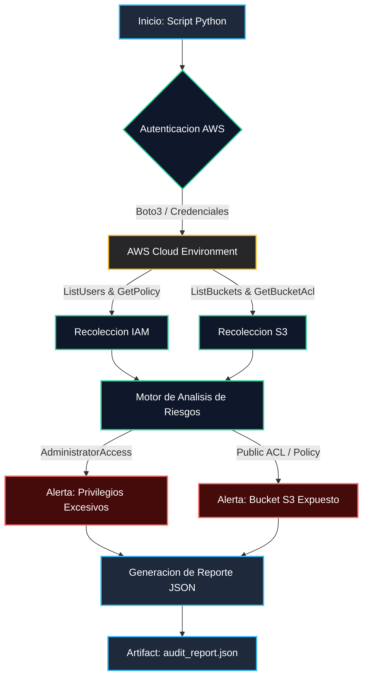

# Project 01: Cloud Identity & S3 Security Auditor

Herramienta automatizada de auditoria y cumplimiento normativo para infraestructura en Amazon Web Services (AWS), enfocada en analisis de politicas IAM y exposicion de buckets S3.

## Estructura del Modulo
- **scripts/**: Contiene el codigo en Python () encargado de interactuar con la API de AWS mediante Boto3.
- **reports/**: Almacena los resultados generados en formato JSON ().
- **architecture/**: Diagramas y recursos visuales especificos del proyecto.
- **docs/**: Documentacion tecnica y notas de cumplimiento.

## Diagrama de Arquitectura y Flujo



## Uso Rapido
Para ejecutar el auditor de identidad y seguridad:
```bash
python3 scripts/audit_iam.py
```
