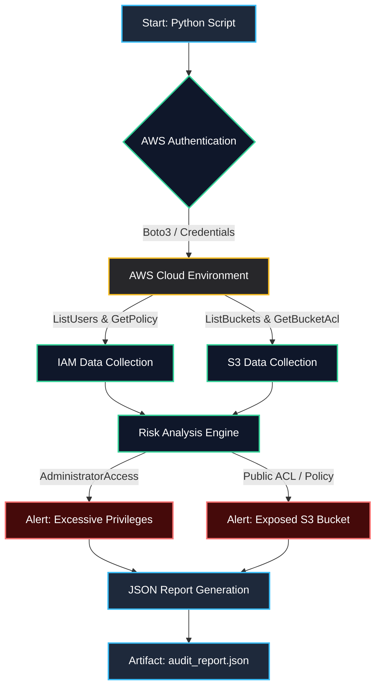

# Project 01: Cloud Identity & S3 Security Auditor

Automated auditing and compliance tool for Amazon Web Services (AWS) infrastructure, focusing on IAM policy analysis and S3 bucket exposure detection.

## Module Structure
- **scripts/**: Contains the core Python script () interacting with the AWS API via Boto3.
- **reports/**: Stores generated security findings in JSON format ().
- **architecture/**: Project-specific visual diagrams and assets.
- **docs/**: Technical documentation and compliance notes.

## Architecture & Audit Flow Diagram



## Quickstart
To execute the identity and security auditor:
```bash
python3 scripts/audit_iam.py
```
