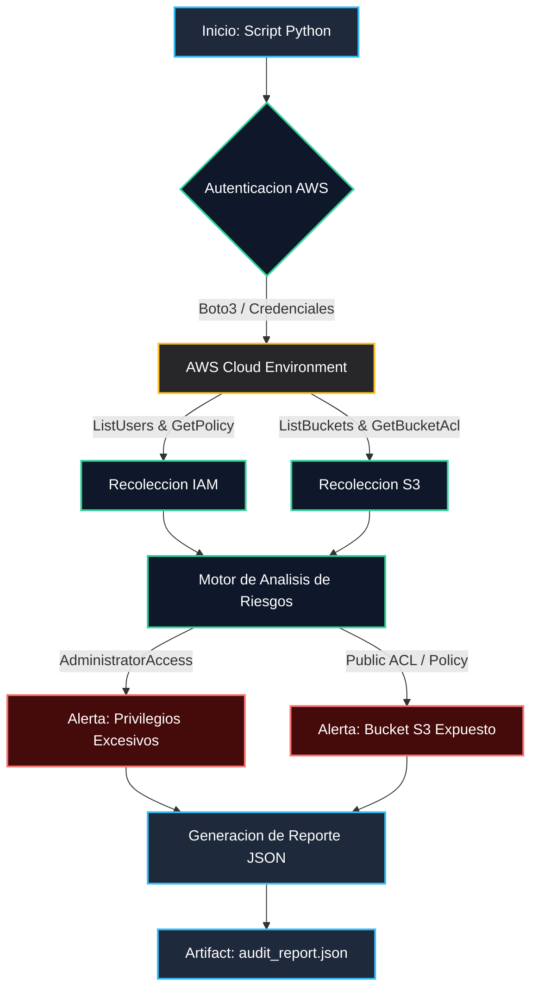

# AWS Security Engineering Portfolio

Repositorio especializado en arquitectura de seguridad, cumplimiento normativo y hardening de infraestructura en Amazon Web Services (AWS).

## Estructura del Repositorio
- **Project-01-Cloud-Identity-Auditor/**: Auditoría automatizada de políticas IAM, control de accesos y análisis de exposición de buckets S3 mediante scripts de Python orientados a cumplimiento normativo y estándares de seguridad.

## Diagrama de Arquitectura y Flujo de Auditoria

